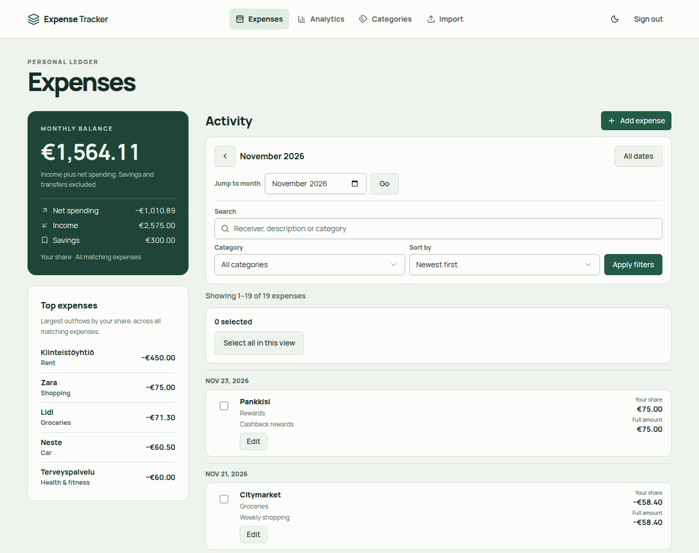
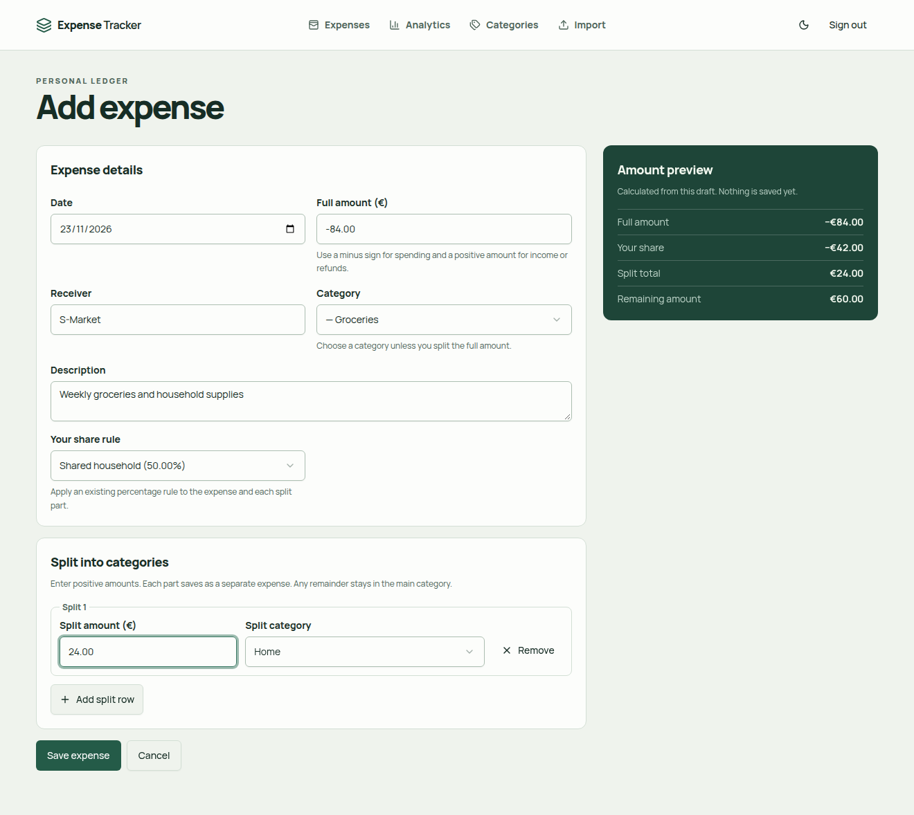
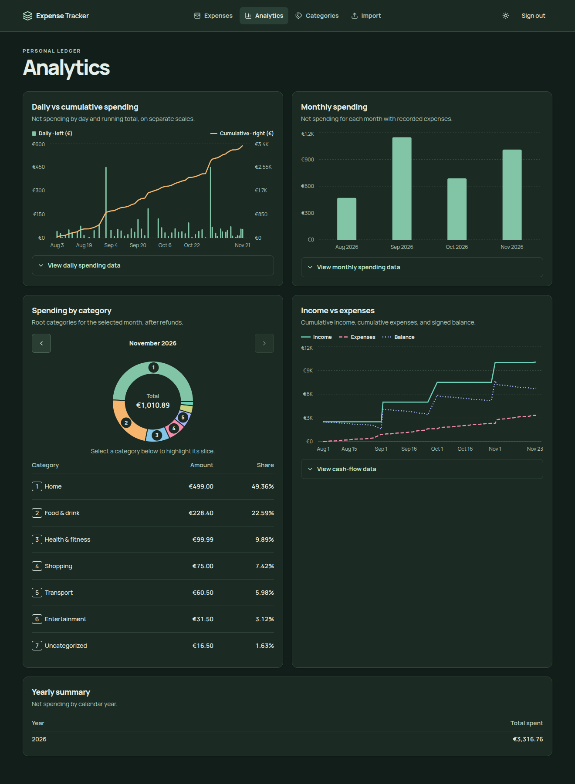
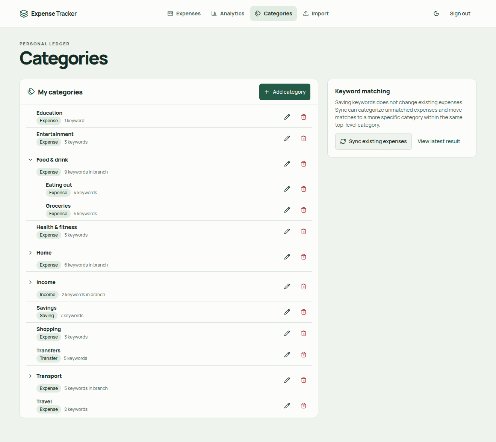
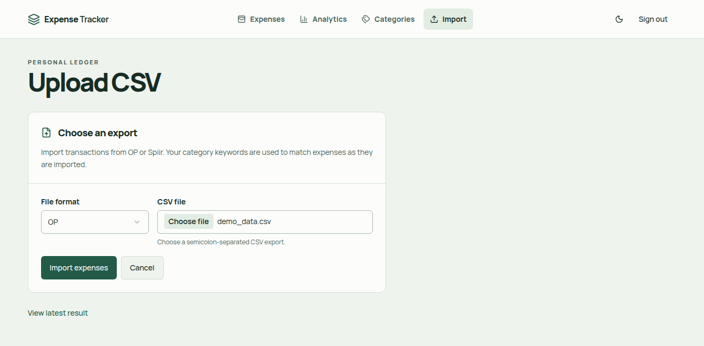

# Expense Tracker

A personal finance web app for tracking expenses and income, built with Django and React. Import transactions from your bank's CSV export, auto-categorize them, and visualize spending trends with interactive charts.

> Personal project built while learning Django.

## Features

- Filter transactions by date, category or search text. Review balances, totals and top expenses.
- Add, edit and delete expenses. Set personal shares for shared expenses or split one transaction across categories.
- Manage categories and keyword rules. Run category sync explicitly to apply rules to existing expenses.
- Import OP or Spiir CSV files and review the import results.
- Explore daily and monthly spending, category breakdowns, cash flow and yearly totals. Open chart data tables for exact amounts.

## Screenshots



<details>
<summary>More screenshots: add expense, analytics, categories, and CSV import</summary>









</details>

## Tech Stack

- **Python 3.13** / **Django 5.2**
- **React** / **TypeScript** / **Vite** / **shadcn/ui** — screens and Recharts charts
- **SQLite** — local database
- **uv** — dependency management

## Getting Started

### Prerequisites

- Python 3.13+
- [uv](https://docs.astral.sh/uv/)
- Node.js 20.19+ on Node 20, or 22.12+, and npm

### Local development

Run from the checkout in a Linux or macOS shell. The runner uses a separate local SQLite file. Migrate it and create a test account first:

```bash
uv sync --locked
npm ci --prefix frontend
DB_PATH="$PWD/expense_tracker/pilot.sqlite3" uv run python expense_tracker/manage.py migrate
DB_PATH="$PWD/expense_tracker/pilot.sqlite3" uv run python expense_tracker/manage.py createsuperuser
uv run python scripts/dev.py
```

Open [http://127.0.0.1:8000/expenses/](http://127.0.0.1:8000/expenses/) and sign in. Use the Django URL as shown (not `localhost`). Django serves pages and the session-protected API; Vite serves development assets and refresh. Ctrl+C stops both servers. Set `DJANGO_PORT` and `VITE_PORT` to use other ports, or set an absolute `DB_PATH` for both setup and the runner to use a different database.

All app screens use React with Django sessions. If a session expires while editing, sign in again on the same page to recover the draft. Drafts are not saved across reloads, and signing in never resubmits a write. Django admin stays at `/admin/`.

This is a **local-only** workflow. Plain Django can still serve admin and the API, but app screens need the Vite dev server. The build below checks the frontend; it does not configure Django to serve production assets.

Focused checks:

```bash
work=$(mktemp -d)
DB_PATH="$work/expenses.sqlite3" uv run pytest --reuse-db \
  expense_tracker/expenses/{test_pilot,test_session_api,test_expense_forms_api,test_expense_deletion,test_expense_bulk_api,test_category_api,test_category_sync,test_csv_import,test_analytics,tests}.py
npm run build --prefix frontend
```

### Demo Data

A sample CSV file (`demo_data.csv`) is included with realistic dummy transactions in the OP bank format. Upload it via the CSV import page to quickly populate the app with data for testing.

## CSV Import Formats

Two bank export formats are supported:

### OP (Osuuspankki) CSV

Semicolon-delimited with Finnish column headers:

| Column | Description |
|---|---|
| `Arvopäivä` | Transaction date |
| `Selitys` | Description |
| `Määrä EUROA` | Amount (negative = expense, positive = income) |
| `Saaja/Maksaja` | Receiver / payer |
| `Viesti` | Message / note |

Decimal commas (`,`) are handled automatically.

### Spiir CSV

Semicolon-delimited export from the [Spiir](https://spiir.dk) app:

| Column | Description |
|---|---|
| `Date` | Transaction date (`DD-MM-YYYY`) |
| `Amount` | Amount |
| `Text` | Receiver / payer |
| `Note` | Description / note |
| `Category` | Category label |

## Running Tests

Run from repository root (collects both Django test classes and pytest functions):

```bash
uv run pytest --reuse-db
uv run pytest --reuse-db expense_tracker/expenses/test_analytics.py
```
